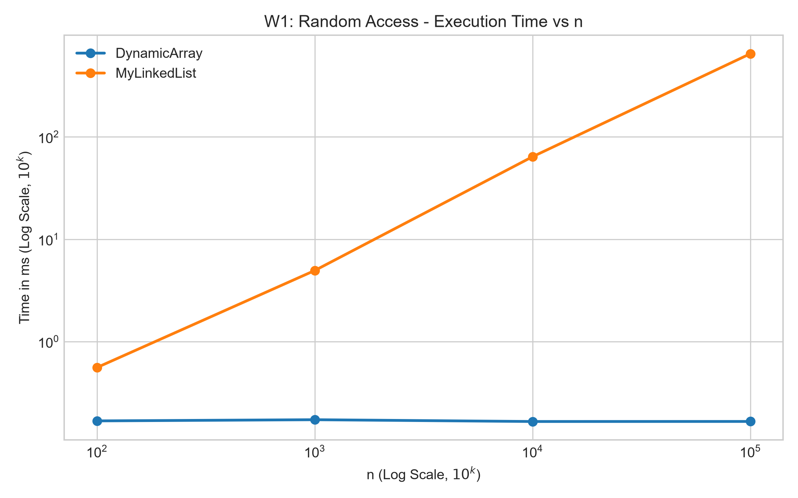
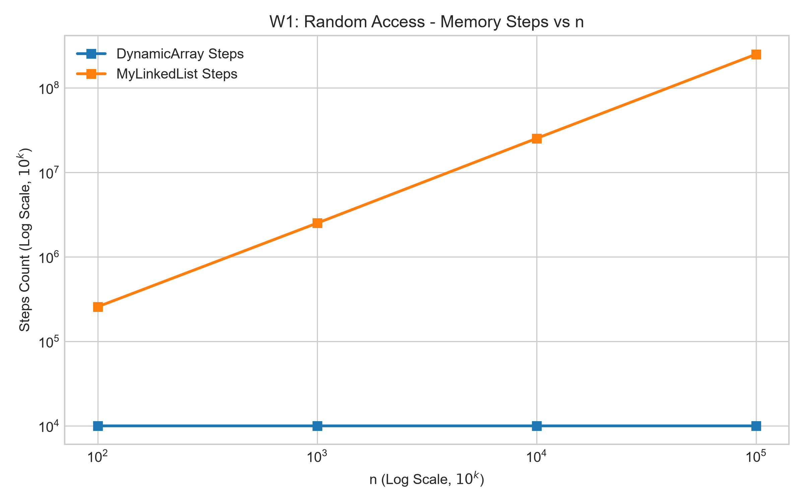
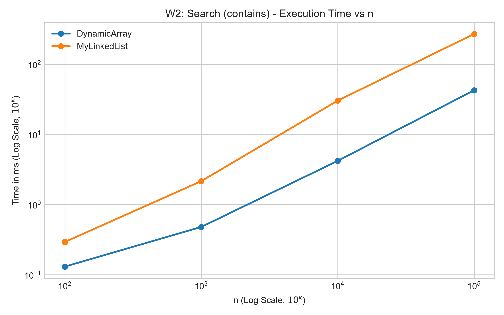
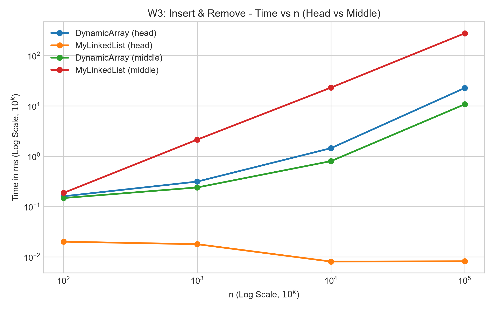
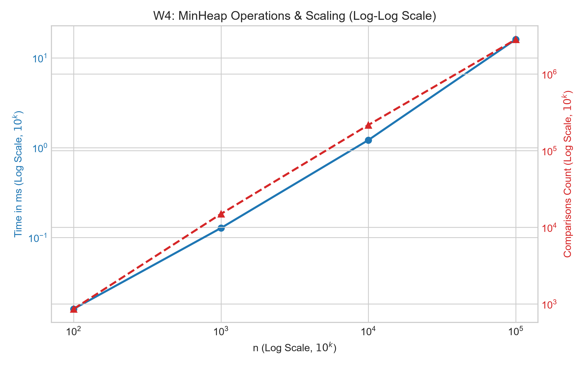

# Assignment 2 Report

**Course:** Design and Analysis of Algorithms
**Student:** Sadykov Nurali, group SE-2509
**Deadline:** 04.10.2026 23:59
**Repository:** https://github.com/SadykovNurali/DAA_Assignment2 (branch `main`, tag `v1.0`)

---

## 1. Implementation summary

- **DynamicArray:** primitive `int[]`, initial capacity 10, grows 2x when full.
- **MyLinkedList:** doubly linked list of nodes holding a primitive `int`, with `head` and `tail`. The counters show that `get(i)` costs about n/4 hops on average (255 745 steps for 10 000 random gets at n = 100, 2 497 236 at n = 1 000), which is what a traversal from the nearer end gives.
- **MinHeap:** array-based binary min-heap with `insert` (bubble-up), `peekMin` and `extractMin` (bubble-down). It also contains Floyd's bottom-up `buildHeap` (bonus, see section 8).
- **Counters**, incremented inside the methods:
  - `steps`: one read of an array cell or one move to the next node (`cur = cur.next`);
  - `moves`: one element shifted in the array or one pointer update in the list;
  - `comparisons`: one comparison of two elements (`a[i] == x`, `heap[left] < heap[right]`).
- **Errors:** `IndexOutOfBoundsException` for invalid indices in `get`, `add(index, x)` and `remove`; `IllegalStateException` for `peekMin` and `extractMin` on an empty heap.

---

## 2. Complexity table

Θ is used when the best and worst bounds coincide. Otherwise Ω is the lower and O the upper bound. n is the size, h = ⌊log₂ n⌋ is the heap height. "Aux. space" is the extra memory needed by the operation itself.

| Structure | Operation | Best | Average | Worst | Aux. space | Justification |
|---|---|---|---|---|---|---|
| **DynamicArray** | `get(i)` | Θ(1) | Θ(1) | Θ(1) | Θ(1) | direct offset: base + i · 4 bytes |
| | `add(x)` | Θ(1) | Θ(1) amortized | O(n) | O(n) | copy only when full; total copying 1+2+4+…+n < 2n |
| | `add(i, x)` | Ω(1) (i = size) | Θ(n) | O(n) (i = 0) | O(n) | shifts size − i elements right; growth needs a new array |
| | `remove(i)` | Ω(1) (last) | Θ(n) | O(n) (i = 0) | Θ(1) | shifts size − i − 1 elements left |
| | `contains(x)` | Ω(1) (first) | Θ(n) | O(n) | Θ(1) | linear scan; an absent value reads all n cells |
| **MyLinkedList** | `get(i)` | Ω(1) (first/last) | Θ(n) | O(n) (middle) | Θ(1) | walks from the nearer end, average n/4 hops |
| | `add(x)` | Θ(1) | Θ(1) | Θ(1) | Θ(1) | append through `tail` |
| | `add(i, x)` | Ω(1) (head/tail) | Θ(n) | O(n) | Θ(1) | walk to the position, then O(1) pointer updates |
| | `remove(i)` | Ω(1) (head/tail) | Θ(n) | O(n) | Θ(1) | walk to the position, then O(1) pointer updates |
| | `contains(x)` | Ω(1) (first) | Θ(n) | O(n) | Θ(1) | sequential traversal from `head` |
| **MinHeap** | `peekMin()` | Θ(1) | Θ(1) | Θ(1) | Θ(1) | returns `heap[0]` |
| | `insert(x)` | Ω(1) | O(1) on random data | O(log n) | O(n) at growth | bubble-up climbs at most h levels; expected climb is constant on random input |
| | `extractMin()` | Ω(1) (all keys equal) | Θ(log n) | Θ(log n) | Θ(1) | the moved last element usually sinks to the bottom, at most h levels |

---

## 3. Loop invariant proofs

### 3.1 `DynamicArray.contains(x)`

```java
for (int i = 0; i < size; i++) {
    if (a[i] == x) return true;
}
return false;
```

- **Invariant:** before each iteration with index `i` (0 ≤ i ≤ size), the value `x` does not occur in `a[0..i-1]`.
- **Initialization:** before the first iteration `i = 0`, the range `a[0..-1]` is empty, so the statement is true.
- **Maintenance:** assume `x` is not in `a[0..i-1]`. If `a[i] == x`, the loop returns and does not continue. Otherwise `a[i] != x`, so `x` is not in `a[0..i]`, which is the invariant for `i + 1`.
- **Termination:** the loop stops either by `return true` or because `i = size`. In the second case the invariant says that `x` is not in `a[0..size-1]`.
- **Conclusion:** if the method returns `true`, then `a[i] == x` was observed at a valid index. If it returns `false`, the invariant at termination proves that `x` is absent. `i` grows by 1 up to `size`, so the loop ends after at most n iterations.

### 3.2 `MinHeap.bubbleDown(int index)`

```java
private void bubbleDown(int index) {
    while (true) {
        int left = 2 * index + 1;
        int right = 2 * index + 2;
        int smallest = index;

        if (left < size && heap[left] < heap[smallest]) smallest = left;
        if (right < size && heap[right] < heap[smallest]) smallest = right;

        if (smallest != index) {
            swap(index, smallest);
            index = smallest;
        } else {
            break;
        }
    }
}
```

Called from `extractMin` with `index = 0` after the last element has been moved to the root.

- **Invariant:** before each iteration, (a) every parent-child pair of the array satisfies `heap[parent] <= heap[child]`, except possibly the pairs `(index, child of index)`; (b) if `index` has a parent, then `heap[parent(index)] <= heap[c]` for both children `c` of `index`.
- **Initialization:** at the first iteration `index = 0`. Before the removal both subtrees of the root were valid heaps, and moving the last element to the root can only break the pairs `(0, 1)` and `(0, 2)`, so (a) holds. The root has no parent, so (b) is vacuous.
- **Maintenance:** let `smallest` be the position of the minimum of `heap[index]`, `heap[left]`, `heap[right]`. If `smallest == index`, the loop breaks (see Termination). Otherwise `smallest = c` is the smaller child, and the swap puts the old `heap[c]` at `index` and the old `heap[index]` at `c`. The new value at `index` is not larger than the other child and not larger than the value now at `c`, so the pairs below `index` are valid. By (b) it is also not smaller than `heap[parent(index)]`, so the pair above `index` is valid. The only pairs that may still be broken are `(c, children of c)`, so (a) holds for the new `index = c`. Property (b) holds for `c`, because the new `heap[index]` is the minimum of the three and, before the swap, the value at `c` was not larger than its own descendants.
- **Termination:** the loop stops when `smallest == index`, that is, when `heap[index]` is not larger than either child (or `index` has no children, so `left >= size`). Each iteration moves `index` at least one level down (`index` at least doubles), so there are at most ⌊log₂ n⌋ iterations.
- **Conclusion:** at termination the pairs `(index, children)` are valid, and by (a) all other pairs were already valid, so the whole array satisfies `heap[parent] <= heap[child]`. Therefore `extractMin` returns the minimum and leaves a valid heap, in O(log n) time.

---

## 4. Benchmark results

All times are medians of 5 runs after 5 discarded warm-up runs, seed `new Random(42)`. Counters are exact and deterministic. `results/results.csv` contains 36 data rows.

### 4.1 Time (ms)

| Workload | Structure | n = 100 | n = 1 000 | n = 10 000 | n = 100 000 |
|---|---|---|---|---|---|
| W1 | DynamicArray | 0.1678 | 0.1723 | 0.1655 | 0.1657 |
| W1 | MyLinkedList | 0.5576 | 4.9467 | 64.0558 | 650.1191 |
| W2 | DynamicArray | 0.1305 | 0.4800 | 4.1958 | 42.6525 |
| W2 | MyLinkedList | 0.2931 | 2.1582 | 30.3088 | 270.4517 |
| W3 head | DynamicArray | 0.1604 | 0.3140 | 1.4478 | 22.6886 |
| W3 head | MyLinkedList | 0.0201 | 0.0179 | 0.0081 | 0.0082 |
| W3 middle | DynamicArray | 0.1480 | 0.2401 | 0.8002 | 10.7755 |
| W3 middle | MyLinkedList | 0.1870 | 2.1428 | 23.1432 | 276.9461 |
| W4 | MinHeap | 0.0160 | 0.1274 | 1.2146 | 16.0469 |

### 4.2 Exact counters at n = 100 000

| Workload | Structure | steps | moves | comparisons |
|---|---|---|---|---|
| W1 | DynamicArray | 10 000 | 0 | 0 |
| W1 | MyLinkedList | 248 896 755 | 0 | 0 |
| W2 | DynamicArray | 74 565 647 | 0 | 74 565 647 |
| W2 | MyLinkedList | 74 565 647 | 0 | 74 565 647 |
| W3 head | DynamicArray | 201 000 000 | 201 000 000 | 0 |
| W3 head | MyLinkedList | 1 000 | 4 000 | 0 |
| W3 middle | DynamicArray | 101 000 000 | 101 000 000 | 0 |
| W3 middle | MyLinkedList | 100 001 999 | 7 000 | 0 |
| W4 | MinHeap | 5 762 852 | 4 302 697 | 2 831 426 |

How to read the counters:

- In `DynamicArray` every shifted element is counted as one step and one move, so `steps = moves` in W3. For the head variant the number of shifts is about 2 · 1000 · (n + 500) = 201 000 000 at n = 100 000, which matches the table.
- In W1 the list needs about n/4 hops per `get` (248 896 755 / 10 000 ≈ 24 890), not n/2, because the traversal starts from the nearer end.
- In W2 the list and the array make exactly the same number of comparisons, so any time difference comes from memory access, not from the algorithm.
- In W3 head the list needs 1 000 steps and 4 000 pointer updates for 2 000 operations, independent of n. In W3 middle it needs about n/2 hops per operation (100 001 999 ≈ 2 000 · 50 000) and 7 000 pointer updates, so the list counters are not zero.
- W4 time and counters cover the n calls of `extractMin`; the counters are reset after the n inserts. The sorted order of the output is checked on every call.

---

## 5. Performance plots

### 5.1 W1: Random access



*Figure 1: time for 10 000 `get(i)` calls (ms, log-log scale).* The array stays at about 0.17 ms for every n (1 step per call), while the list grows from 0.56 ms to 650 ms, about 3 900 times slower at n = 100 000.



*Figure 2: steps for W1.* The array makes exactly 10 000 steps, the list about n/4 steps per call.

### 5.2 W2: Search



*Figure 3: time for 1 000 `contains(x)` queries.* Both structures make the same number of comparisons and grow about 10x per 10x of n (Θ(n)). At n = 100 000 the array needs 42.7 ms and the list 270.5 ms, 6.3 times slower. The ratio grows with n (2.2x, 4.5x, 7.2x, 6.3x) as the list stops fitting into the CPU caches: about 0.57 ns per step for the array against 3.6 ns per step for the list.

### 5.3 W3: Insert and remove



*Figure 4: 1 000 insertions and 1 000 removals at the head and in the middle.* At the head the list takes about 0.008 ms at large n (Θ(1); the small drift between 0.02 and 0.008 ms is JIT and timer noise at microsecond scale), while the array needs 22.7 ms at n = 100 000, about 2 800 times more. In the middle the order flips: the list takes 276.9 ms and the array 10.8 ms, a factor of 25.7. Both are Θ(n) there, but the array shifts contiguous memory while the list walks about n/2 nodes.

### 5.4 W4: Priority processing



*Figure 5: MinHeap time and counters for n calls of `extractMin`.* The time is 16.0 ms at n = 100 000, and the counters grow like n log n (5.76 million steps). The output was non-decreasing for every n.

---

## 6. Discussion

**Why the array is faster.** `get(i)` in the array costs one step because the address of cell `i` is computed directly, while the list needs about n/4 pointer hops (W1: 0.17 ms against 650 ms at n = 100 000). The array also wins on a plain scan, because its `int` values lie next to each other in memory. One 64-byte cache line holds 16 ints, so one memory fetch serves 16 consecutive elements, and the CPU prefetcher loads the next lines before they are needed (spatial locality).

**Why equal step counts still give different times.** In W2 both structures make exactly the same number of comparisons, yet the list is 6.3 times slower at n = 100 000, so equal Big-O and equal operation counts do not mean equal running time. The reason is pointer chasing: the address of the next node is known only after the current node has been read, so the CPU cannot prefetch and waits for every load, which costs a main-memory access of tens of nanoseconds when the node is not in cache. List nodes are separate objects that can be scattered over the heap, and each node carries an object header and references, so about 24-32 bytes are spent on 4 bytes of data, which fills the cache with overhead. Every inserted node is a new allocation and every removed node becomes garbage, which adds work for the garbage collector in W3. The same effect explains W3 middle: both structures are Θ(n), but shifting contiguous memory is 25.7 times cheaper than walking n/2 nodes.

**When to use which structure.** The list is the better choice for insertions and removals at the head (W3 head: a few pointer updates against shifting the whole array, about 2 800 times faster at n = 100 000) when random access by index is not needed. The array is the better default when reads, scans and appends dominate. The MinHeap is the better choice when only the smallest element is needed repeatedly: `peekMin` is Θ(1) and `extractMin` is Θ(log n), instead of Θ(n) for a linear search or Θ(n log n) for repeated sorting, and it uses only index arithmetic (2i + 1, 2i + 2) on a primitive array without node allocation. Finally, the first measurements for small n are distorted by JIT compilation, so the warm-up runs were discarded and the median of 5 warmed-up runs is reported; the counters do not depend on warm-up and are the reliable part of the comparison.

---

## 7. Testing

JUnit 5 tests compare both lists with `java.util.ArrayList` on random data (`Random(42)`) and check an empty structure, one element, duplicates, the first and last index, invalid indices, the heap property `a[parent] <= a[child]` after every `insert` and `extractMin`, and sorted output of n calls of `extractMin`. Run them with `mvn clean test`.

---

